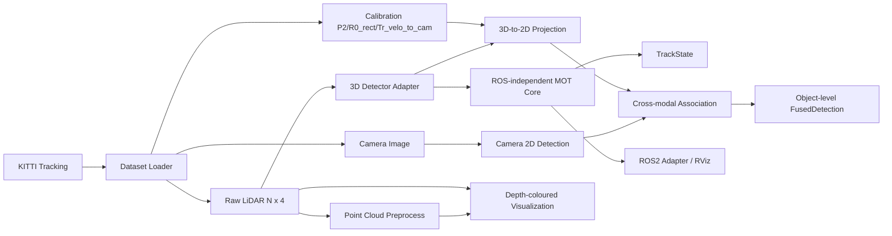
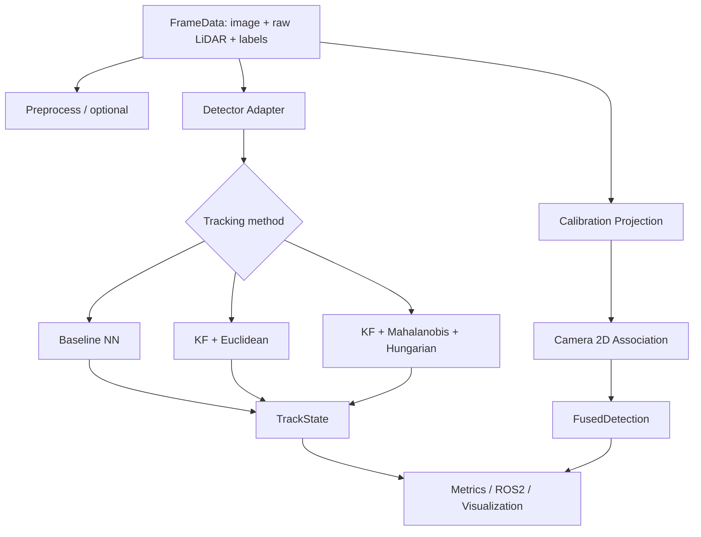
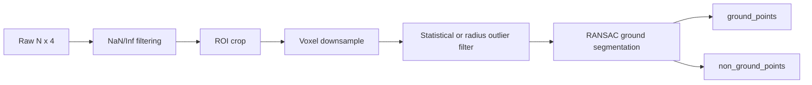

# robot-perception-mot

面向 KITTI Tracking 的 Camera-LiDAR 3D 感知与多目标跟踪工程。项目将数据读取、
点云预处理、坐标变换、检测适配、状态估计、数据关联、轨迹生命周期、跨模态一致性
检查、离线可视化和 ROS2 replay 保持为职责明确的模块。


## 1. Project Overview

系统以 KITTI Tracking 的图像、Velodyne 点云、标定和标签为输入，提供：

- KITTI Tracking 的标准目录与分拆下载目录读取；
- ROI、Voxel、离群点过滤与 RANSAC 地面分割；
- KITTI 标定解析及向量化 LiDAR -> Camera -> Rectified Camera -> Image 投影；
- 独立实现的 3D Constant Velocity Kalman Filter；
- Mahalanobis gating、Hungarian assignment 与 Track 生命周期；
- GT/NoisyGT/PointPillars 输出适配，以及实验性 Camera-LiDAR object-level fusion；
- 可复现的 baseline benchmark、深度着色可视化、MP4 和 ROS2 Humble replay。

## 2. Motivation

机器人感知工程的难点不只在单个模型，而在传感器数据、坐标系、时间序列状态和
可观测结果之间建立可靠边界。本项目使用成熟的 KITTI 数据和公开 PointPillars 权重，
将重点放在可测试的 3D tracking 与多传感器几何流程上。

## 3. System Architecture



模块之间通过 `FrameData`、`Detection3D`、`TrackState` 等 dataclass 通信。
Tracker 不导入 `rclpy`，也不依赖具体 Detector。

端到端执行顺序如下；benchmark 的三个 tracker 分支共享同一 detection stream：



## 4. Dataset

主数据集为 [KITTI Tracking](https://www.cvlibs.net/datasets/kitti/eval_tracking.php)，
使用 `image_02`、`velodyne`、`calib`、`label_02`。当前默认配置位于
`configs/dataset.yaml`，开发与已运行实验使用 sequence `0000`；配置也列出 `0001`
和 `0002` 供后续扩展。

- `FrameData.image`：OpenCV BGR 图像；
- `FrameData.lidar_points`：`float32`，形状为 `N x 4`，列为 `[x, y, z, intensity]`；
- KITTI Tracking 标签保留 `sequence_id`、`frame_id`、`track_id`、类别、2D bbox、
  尺寸、位置与 `rotation_y`；
- KITTI label 位置和 3D box 在 camera 坐标系，PointPillars 输出在 LiDAR 坐标系。

## 5. Environment

目标环境为 Ubuntu 22.04、ROS2 Humble、Python 3.10、PyTorch 2.1.2+cu118、
CUDA 11.8。主项目与旧版 MMDetection3D PointPillars 使用**两套隔离环境**，
不能混装。

主项目已使用的核心版本：

```text
conda env: robot-perception-mot
Python:    3.10
PyTorch:   2.1.2+cu118
NumPy:     1.26.4
SciPy:     1.11.4
ROS2:      Humble
```

## 6. Installation

从仓库根目录执行。先让 shell 可使用 conda：

```bash
source "$(conda info --base)/etc/profile.d/conda.sh"
conda create -n robot-perception-mot python=3.10 -y
conda activate robot-perception-mot

pip install torch==2.1.2 torchvision==0.16.2 \
  --index-url https://download.pytorch.org/whl/cu118
pip install numpy==1.26.4 scipy==1.11.4 opencv-python open3d pyyaml \
  tqdm matplotlib scikit-learn filterpy lap motmetrics pytest
```

项目采用 `src/` 布局；仓库内脚本会从根目录定位 `src/robot_perception`，无需额外
安装主包。验证基础环境：

```bash
conda run -n robot-perception-mot python -m pytest tests/
```

## 7. Dataset Preparation

下载 KITTI Tracking 的 image、velodyne、calib 与 label 压缩包，解压到 `data/`。
Loader 兼容以下任一布局，数据和权重均被 Git 忽略：

```text
# 当前本地分拆下载布局
data/
├── data_tracking_image_2/training/image_02/0000/000100.png
├── data_tracking_velodyne/training/velodyne/0000/000100.bin
├── data_tracking_calib/training/calib/0000.txt
└── data_tracking_label_2/training/label_02/0000.txt

# 也兼容标准布局
data/training/{image_02,velodyne,calib,label_02}/
```

修改 `configs/dataset.yaml` 中的相对 `dataset.root` 即可切换数据位置；不要把绝对
数据路径、KITTI 数据或模型权重提交到 Git。

## 8. Quick Start

激活 `robot-perception-mot` 后，在仓库根目录依次运行：


```bash
# 读取一帧并检查图像、点云和标签
python scripts/inspect_kitti.py --sequence 0000 --frame 100

# 执行完整点云预处理并打印各阶段点数
python scripts/run_pointcloud_preprocess.py --sequence 0000 --frame 100

# 输出 raw/non-ground 深度着色 fusion 图
python scripts/run_fusion_demo.py --sequence 0000 --frame 100

# 运行同一输入下的三种 MOT baseline，生成 JSON、图表和实验报告
python scripts/evaluate.py --config configs/pipeline.yaml --sequence 0000

# 运行单元测试
python -m pytest tests/
```

`evaluate.py` 默认处理 sequence `0000` 的整个配置帧范围。真实 PointPillars 推理和
ROS2 replay 的独立环境要求见后文。

## 9. Point Cloud Pipeline



实现位于 `src/robot_perception/pointcloud/`。ROI、体素大小、离群点和 RANSAC 参数
全部来自 `configs/pipeline.yaml`。`preprocess_point_cloud()` 会保留 raw、valid、ROI、
voxel、outlier、ground 与 non-ground 各阶段数组及 shape，空点云安全返回。

## 10. Calibration

`dataset/calibration.py` 解析 KITTI `P2`、`R0_rect`、`Tr_velo_to_cam`；
`common/geometry.py` 使用 NumPy 向量化实现：

```text
LiDAR xyz --Tr_velo_to_cam--> Camera
           --R0_rect-------> Rectified Camera
           --P2------------> Image pixel (u, v)
```

投影会显式使用 homogeneous coordinate，并过滤 NaN/Inf、相机后方点与图像 FOV 外点。
这一步是**几何 projection**，不是 sensor fusion。

## 11. Detection

`BaseDetector.predict(frame) -> list[Detection3D]` 是 Tracker 的唯一 Detector 边界。

- `GTDetector`、`NoisyGTDetector`：将 KITTI 标签标准化为 `Detection3D`；只可用于
  tracking pipeline validation；
- `MMDet3DPointPillarsAdapter`：将 MMDetection3D `boxes_3d`、`scores_3d`、
  `labels_3d` 映射为统一输出；官方三类映射为 Pedestrian -> 2、Cyclist -> 3、Car -> 1；
- `Detection3D`：统一为 `position`、`dimensions`、`yaw`、`score`、`class_id`。

### Real detector experiment

本地已完成官方 PointPillars KITTI checkpoint 的单帧和 `0000` 全序列端到端接入验证。
YOLO26 2D detector 使用 KITTI 三类标签微调后导出 ONNX，由主项目环境的 OpenCV DNN
加载；PointPillars 3D detector 保持在独立的 `mmdet3d-kitti` 环境。

旧版 PointPillars 必须使用独立环境，避免破坏主项目：

```bash
source "$(conda info --base)/etc/profile.d/conda.sh"
conda create -n mmdet3d-kitti python=3.8 -y
conda activate mmdet3d-kitti

# 网络较慢时可临时设置代理，完成后执行 unset。
export HTTP_PROXY=http://192.168.109.107:7890
export HTTPS_PROXY=http://192.168.109.107:7890

pip install torch==1.10.0+cu113 torchvision==0.11.1+cu113 \
  --extra-index-url https://download.pytorch.org/whl/cu113
pip install numpy==1.20.3 Pillow==9.5.0
pip install mmcv-full==1.6.0 \
  -f https://download.openmmlab.com/mmcv/dist/cu113/torch1.10/index.html
pip install mmdet==2.28.2 mmsegmentation==0.30.0
git clone --branch v1.0.0rc6 --depth 1 \
  https://github.com/open-mmlab/mmdetection3d.git mmdetection3d-1.0
pip install -v -e ./mmdetection3d-1.0

unset HTTP_PROXY HTTPS_PROXY
```

版本组合必须保持：Python 3.8、PyTorch 1.10.0+cu113、MMCV 1.6.0、
MMDetection 2.28.2、MMDetection3D 1.0.0rc6、NumPy 1.20.3、Pillow 9.5.0。

YOLO26 的训练和 ONNX 导出使用从主环境继承依赖的临时 venv，不向
`robot-perception-mot` 安装 Ultralytics：

```bash
python -m venv --system-site-packages /tmp/robot-perception-mot-yolo26
/tmp/robot-perception-mot-yolo26/bin/python -m pip install \
  ultralytics==8.4.131 onnx==1.16.0
```

统一权重目录为 `weights/`，包含原始 `yolo26s.pt`、训练后的
`yolo26s_kitti3class.pt`/`.onnx` 和 PointPillars `.pth`；这些大文件均被 Git 忽略。

官方配置和三分类 checkpoint（`Pedestrian/Cyclist/Car`）下载地址：

```text
https://download.openmmlab.com/mmdetection3d/v1.0.0_models/pointpillars/
hv_pointpillars_secfpn_6x8_160e_kitti-3d-3class/
hv_pointpillars_secfpn_6x8_160e_kitti-3d-3class_20220301_150306-37dc2420.pth
```

将配置放在 `mmdetection3d-1.0/configs/pointpillars/`，checkpoint 放在仓库根目录，
或修改 `configs/detector.yaml` 的 `real.config` 与 `real.checkpoint`。运行前检查：

```bash
nvidia-smi
test -f mmdetection3d-1.0/configs/pointpillars/hv_pointpillars_secfpn_6x8_160e_kitti-3d-3class.py
test -f hv_pointpillars_secfpn_6x8_160e_kitti-3d-3class_20220301_150306-37dc2420.pth
python -c "import torch,mmcv,mmdet,mmdet3d,numpy,PIL; print(torch.__version__, torch.version.cuda, mmcv.__version__, mmdet.__version__, mmdet3d.__version__, numpy.__version__, PIL.__version__)"
```

在 `mmdet3d-kitti` 环境中，可先运行官方单帧 demo：

```bash
CUDA_VISIBLE_DEVICES=0 python mmdetection3d-1.0/demo/pcd_demo.py \
  data/data_tracking_velodyne/training/velodyne/0000/000100.bin \
  mmdetection3d-1.0/configs/pointpillars/hv_pointpillars_secfpn_6x8_160e_kitti-3d-3class.py \
  hv_pointpillars_secfpn_6x8_160e_kitti-3d-3class_20220301_150306-37dc2420.pth \
  --device cuda:0 --score-thr 0.3 --out-dir /tmp/pointpillars_demo
```

再将 checkpoint 路径配置到 `configs/detector.yaml` 后，可运行项目 adapter：

```bash
CUDA_VISIBLE_DEVICES=0 python scripts/run_detection.py \
  --detector real --sequence 0000 --frame 100
```

### YOLO26 KITTI 三类训练与 ONNX

`yolo26s.pt` 是 COCO 预训练模型，先由 `scripts/prepare_kitti_yolo.py` 将 KITTI
`label_02` 转成 YOLO 格式，再在临时环境训练三类 head。当前已生成 8,008 帧、45,198
个框的训练集（17 个 train sequence、4 个 val sequence，图像使用符号链接）：

```bash
python scripts/prepare_kitti_yolo.py --output data/yolo26_kitti_trainset
/tmp/robot-perception-mot-yolo26/bin/python scripts/train_yolo26_kitti.py \
  --epochs 10 --device 0
/tmp/robot-perception-mot-yolo26/bin/python scripts/export_yolo26_onnx.py
```

训练配置位于 `configs/yolo26_train.yaml`，数据类别顺序固定为：`Car`、`Pedestrian`、
`Cyclist`。本次 10 epoch 实际验证结果为 Precision `0.62777`、Recall `0.53965`、
mAP50 `0.53000`、mAP50-95 `0.32233`；这是 2D detector 验证结果，不等同于 MOT 指标。

另外提供严格 hold-out 配置 `configs/yolo26_kitti_holdout.yaml`：sequence `0000` 的
154 帧完全不进入训练，只用于验证。当前 hold-out 训练已完成 10 epochs，验证结果
为 Precision `0.55334`、Recall `0.50818`、mAP50 `0.43773`、mAP50-95 `0.30819`；
该权重和 ONNX 位于 `weights/yolo26s_kitti3class_holdout0000.*`，可用
`scripts/run_end_to_end.py --camera-model ...holdout0000.onnx` 做无训练序列泄漏的 replay smoke。

## 12. Kalman Filter

`ConstantVelocityKalmanFilter` 独立实现下列线性模型，不依赖 filterpy 的核心数学：

```text
x = [px, py, pz, vx, vy, vz]^T
z = [px, py, pz]^T
x_k = F(dt) x_(k-1) + w
z_k = H x_k + v
```

支持可变 `dt`、可配置 Q/R/P，更新采用 Joseph covariance form，输入与矩阵 shape
均有 NaN/Inf 检查。合成轨迹实验的实际输出保存在
`outputs/metrics/kalman_baseline.json`：原始测量 RMSE `0.465834`，Kalman filtered
RMSE `0.370640`。

## 13. Data Association

Proposed 关联步骤为 Prediction -> Mahalanobis distance -> gating -> Hungarian：

```text
d^2 = y^T S^-1 y
```

实现使用线性方程求解，避免显式求逆；无效 pair 不会被 Hungarian 的哨兵成本误配。
同时保留 Euclidean nearest-neighbor，作为 benchmark 的对照方法。空 track、空
detection、数量不等和全 pair 无效均有单元测试。

## 14. Multi-Object Tracking

`MultiObjectTracker` 接收 `Detection3D`，执行：

```text
Predict -> Gate/Associate -> Update -> Birth -> Age -> Delete
```

每个 Track 保存递增且不复用的 `track_id`、KF state/covariance、age、hits、
`time_since_update` 与状态。生命周期为 `Tentative -> Confirmed -> Lost -> Deleted`；
`min_hits`、`max_age` 和 gating threshold 由配置控制。

合成漏检轨迹的实际输出位于 `outputs/metrics/tracker_baseline.json`：80 帧、3 个目标、
measurement std `0.35`、miss probability `0.15` 条件下，MOTA `0.770833`、
IDF1 `0.896552`、IDS `10`。这是合成 tracker demo，不是 KITTI Detector 性能。

## 15. Camera-LiDAR Fusion

以下三个概念必须区分：

1. **Camera-LiDAR projection**：把 LiDAR 3D box corners 或点投影到图像；仅是坐标
   变换和可见性过滤。
2. **Cross-modal association**：比较投影 2D box 与 Camera 2D detection 的类别、IoU
   和中心距离，进行一对一匹配。
3. **Camera-LiDAR sensor fusion**：仅对匹配对象生成 `FusedDetection`，保留
   `lidar_detection`、`camera_detection`、`projected_bbox`、`fusion_confidence` 与
   可选 `track_id`。

当前 Camera 侧是 `SyntheticCameraDetector`，它把 KITTI 2D 标签作为 mock 输入，
只用于流程验证；不能据此宣称已经完成真实 Camera detector 或学习式融合。

## 16. ROS2

`ros2_ws/src/perception_tracker` 提供 replay-oriented ROS2 Humble package：

```text
/sensors/lidar/points   sensor_msgs/PointCloud2
/sensors/camera/image   sensor_msgs/Image
/perception/detections  visualization_msgs/MarkerArray
/perception/tracks      visualization_msgs/MarkerArray
```

节点使用 Header 的当前 replay timestamp 与 `lidar`/`camera` frame；`base_link`、
`lidar`、`camera` 的真实变换由外部 TF2 tree 提供，不使用硬编码外参替代 TF。

```bash
source /opt/ros/humble/setup.bash
colcon build --symlink-install --base-paths ros2_ws
source install/setup.bash

ros2 launch perception_tracker perception_tracker.launch.py \
  dataset_root:=data sequence:=0000 start_frame:=100 end_frame:=100 \
  replay_rate:=1.0
```

安装 RViz2 后可追加 `use_rviz:=true`。GT/NoisyGT replay 的 detection 位于 camera
frame；LiDAR Detector 输出必须显式设置 `detection_frame:=lidar`。

### 真实端到端 replay

在 `mmdet3d-kitti` 环境中运行统一脚本，PointPillars 生成 LiDAR 3D box，YOLO26 ONNX
生成 Camera 2D box，随后进入项目 Tracker、3D->2D projection 和 Camera-LiDAR fusion：

```bash
CUDA_VISIBLE_DEVICES=0 /data/weijiaman/miniconda3/envs/mmdet3d-kitti/bin/python \
  scripts/run_end_to_end.py --sequence 0000 --device cuda:0
```

最近一次真实运行处理 154 帧：PointPillars 输出 1,594 个 3D detections，YOLO26 输出
727 个 2D detections，确认轨迹 1,214 个，融合结果 482 个；端到端耗时 16.49 秒，
约 9.34 FPS，平均单帧 94.18 ms（包含两侧 detector、Tracker、projection、fusion
和视频写入）。运行统计完整保存在 `outputs/metrics/end_to_end_0000.json`。

这里的“端到端”指真实 detector 到融合输出的完整 replay：PointPillars 使用 KITTI
原始 `.bin`（不额外做会改变其训练分布的 ground removal），YOLO26 使用 KITTI 三类
相机图像，Tracker 只消费 PointPillars 的 `Detection3D`，最后使用 calibration 将
LiDAR 3D box 投影到图像并与 YOLO26 2D box 进行匹配。点云预处理模块仍可独立运行，
但没有偷偷插入真实 PointPillars 推理链。

## 17. Benchmark

运行：

```bash
python scripts/evaluate.py --config configs/pipeline.yaml --sequence 0000
```

该命令根据 `configs/pipeline.yaml` 预计算一次 detection stream，再让三种方法在
相同 dataset、sequence、帧范围与输入上分别运行：

| Method | Tracking pipeline |
| --- | --- |
| `baseline_nn` | Detection -> Euclidean nearest-neighbor，无 Kalman |
| `baseline_kf` | Detection -> Kalman -> Euclidean association |
| `proposed` | Detection -> Kalman -> Mahalanobis gating -> Hungarian |

输出 `outputs/metrics/baseline_nn.json`、`baseline_kf.json`、`proposed.json`、
`mot_comparison.png` 与 [实验报告](docs/experiments.md)。每个 JSON 保存 Git hash、
完整配置、sequence、帧范围、timestamp、MOTA、IDF1、IDS、FP、FN、CPU peak RSS、
FPS 与 latency；GT input 的 GPU memory 明确写为 `NOT RUN`。

真实 PointPillars 驱动的 MOT 评估使用：

```bash
CUDA_VISIBLE_DEVICES=0 /data/weijiaman/miniconda3/envs/mmdet3d-kitti/bin/python \
  scripts/evaluate_real_mot.py --sequence 0000 --device cuda:0
```

该脚本将 KITTI camera GT box center 通过 calibration 转到 LiDAR 坐标，再与真实
PointPillars -> Tracker 输出匹配；结果写入 `outputs/metrics/real_pointpillars_mot.json`。
这和 GTDetector benchmark 是两个不同实验。

## 18. Results

下表直接整理自当前 `outputs/metrics/*.json`。实验配置为 KITTI Tracking `0000`、
frame `0..153`、154 帧、711 个 GT object、`detector_type: gt`；三种方法使用同一
GT detection input。最近一次运行的 CPU peak RSS 为 `62.94 MB`，GPU memory 为 `NOT RUN`。

| Method | MOTA | IDF1 | IDS | FP | FN | FPS | latency/frame (ms) |
| --- | ---: | ---: | ---: | ---: | ---: | ---: | ---: |
| baseline_nn | 1.0000 | 1.0000 | 0 | 0 | 0 | 6701.92 | 0.149 |
| baseline_kf | 1.0000 | 1.0000 | 0 | 0 | 0 | 1094.63 | 0.914 |
| proposed | 1.0000 | 1.0000 | 0 | 0 | 0 | 1034.87 | 0.966 |

这些数值是 **GT-based tracking validation**：GT detector 没有漏检或定位噪声，
因此三种方法在此输入上都达到 1.0。它们只证明 benchmark、association 和 tracking
链路可复现，**不能**用于比较真实 Detector、PointPillars 或端到端系统的性能。

真实 PointPillars `0000` 全序列评估结果为：GT `711`、matches `448`、FP `766`、
FN `263`、IDS `8`、MOTA `-0.4585`、IDF1 `0.4655`、FPS `25.10`。负 MOTA 表示
当前预训练 detector 的误检/漏检数量已经超过 GT 数量；它是实际 detector-driven
结果，不应被隐藏或替换成 GT benchmark 的 1.0。


## 19. Visualization

`configs/fusion.yaml` 中 `visualization.lidar_points_mode` 支持：

- `raw`：直接投影 `FrameData.lidar_points`，用于 calibration debug；
- `non_ground`：投影完整点云预处理后的 `non_ground_points`，用于最终感知/融合 demo；
- `none`：只显示 object-level fusion boxes。

点颜色来自 rectified camera depth 的 TURBO 色表，而非固定绿色。每次单帧 demo 都
输出同一帧 raw 与 non-ground 图供人工比较；绿色框为 LiDAR 3D box 的 2D 投影，
蓝色框为 Camera 2D detection。


完整 sequence `0000` 的 non-ground 离线视频由 `cv2.VideoWriter` 生成：

```bash
python scripts/render_fusion_video.py --sequence 0000
```

[打开 MP4 视频](outputs/videos/fusion_0000_non_ground.mp4)。可用
`--lidar-points-mode raw` 生成 calibration debug 视频，或以 `--start-frame`、
`--end-frame`、`--fps` 调整范围。

## 20. Limitations

- MOT benchmark 的三个 baseline 仍使用 GT/NoisyGT 输入；它们验证 tracking/association，
  不代表真实 detector 性能。PointPillars + YOLO26 全序列 replay 已可运行，但尚未计算
  标准 detector mAP/recall；真实 PointPillars 驱动的 MOT 指标已记录，但当前结果较弱。
- `SyntheticCameraDetector` 是实验 mock，Camera-LiDAR fusion 目前是几何投影、
  跨模态匹配与规则置信度，不是 neural fusion。
- 当前 IDF1 为基于逐帧位置匹配的可复现 baseline，不替代 MOTChallenge 全局 ID 指标。
- ROS2 节点为 KITTI replay adapter，不是实时传感器驱动；实际部署需要驱动、TF tree
  与时间同步。
- PointPillars 依赖旧版 OpenMMLab 栈，必须在隔离环境运行。

## 21. Future Work

1. 缓存真实 PointPillars + YOLO26 全序列输出，在相同 detection input 下执行端到端 MOT
   benchmark，并记录 detector runtime/GPU memory。
2. 增加 YOLO26 训练增强、类别/遮挡分层评估，并替换当前 10 epoch 实验权重为正式模型。
3. 实现标准 MOTChallenge 全局 IDF1 与更完整的误差分析。
4. 连接真实 ROS2 传感器 topic、TF tree 和时间同步，执行 RViz2 集成测试。
5. 在不破坏模块边界的前提下增加类别一致性 gating、检测缓存和性能 profiling。

## Project Layout

```text
configs/                 YAML 配置
src/robot_perception/    可复用感知核心包
ros2_ws/src/             ROS2 replay adapter
scripts/                 数据检查、demo、benchmark、视频脚本
tests/                   pytest 单元与 smoke tests
docs/                    实验报告
outputs/                 本地生成的 metrics、可视化和视频（不提交）
data/                    本地 KITTI 数据（不提交）
```
